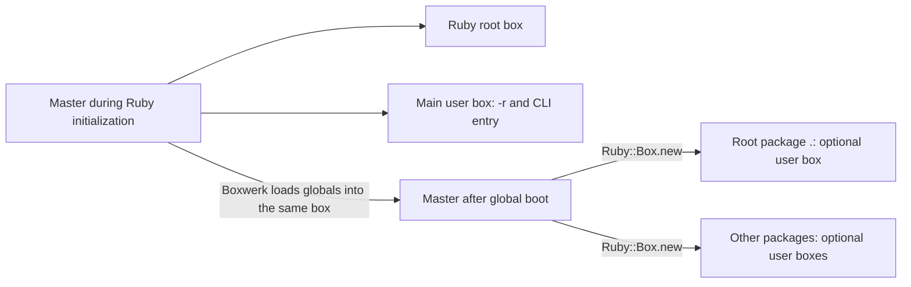

# Architecture

This document describes how Boxwerk works internally.

## Overview

Boxwerk enforces package boundaries at runtime using Ruby::Box isolation. Each package gets its own `Ruby::Box` instance. Constants are resolved lazily on first access and cached. Only direct dependencies are accessible; transitive dependencies are blocked.



Arrows to boxes show initialization from the template, not containment. Both master nodes represent the same box at different times. Root and main already exist when Boxwerk loads application globals.

## Ruby::Box primer

This description targets Ruby 4.0.7. The [source audit and runtime probes](docs/research/ruby-box-model.md) distinguish verified behavior from claims in the [official documentation](https://docs.ruby-lang.org/en/4.0/Ruby/Box.html) that disagree with this release.

### Box roles

Ruby distinguishes master, root, and user boxes. Main and optional boxes are both user boxes.

| Box | Role in Ruby 4.0.7 | Role in Boxwerk |
| --- | --- | --- |
| `Ruby::Box.master` | Holds bootstrap definitions and supplies initial state for new boxes. Bootstrap uses it before root and main exist. | Boxwerk explicitly evaluates shared application boot here. |
| `Ruby::Box.root` | A mandatory runtime box created from master during initialization, with its own gem-prelude setup. | Distinct from the project's root package; not the template for package boxes. |
| `Ruby::Box.main` | A mandatory user box created before command-line `-r` libraries and the program run. Those execute here. | The executable starts here before switching to master. |
| `Ruby::Box.new` | Creates an optional user box from master, regardless of the caller's box. | One per package, including the root package `.`. |

Boxwerk's use of master for application boot is an explicit design choice, not Ruby's default destination for application code. Ruby 4.0.7 exposes `master.eval`, and upstream tests use it, despite the public documentation saying no code runs in master. Likewise, do not assume every built-in method executes in root: bootstrap-defined methods can retain master as their defining box.

### Definitions, objects, and loading state

- **Definition scope.** Methods and procs retain the box in which their code was defined. Calling a package's method from another package does not move its body into the caller's box.
- **Top-level constants.** Each new box captures master's top-level constant table. `Object` itself can have the same identity across boxes while its constant tables differ. `box::Foo` accesses a constant in that box.
- **Class state.** Ruby uses copy-on-write class and module state. A box is not a deep copy or a frozen snapshot of every object and class. Copied constant values can refer to the same mutable objects, and some later changes to shared classes remain visible across boxes.
- **Built-in patches.** Built-in classes such as `String` can have box-specific methods and constants. Package-local patches are separate from definitions placed in master before package creation.
- **Loading state.** New boxes get separate `$LOAD_PATH` and `$LOADED_FEATURES` arrays initialized from master. The arrays track how to find files and which files were already loaded; they do not themselves copy class definitions.
- **Execution versus loading.** `box.eval(code)` executes code in the receiver. `box.require(path)` selects that box for loading. Ruby tracks a loading box separately from the executing method's defining box and uses it to resolve load paths and loaded features.

### Implications for Boxwerk

1. Load shared top-level constants and gems in master before creating package boxes. Loading them into root or main does not seed new optional boxes.
2. Configure global autoload directories during `global/boot.rb`. Do not rely on later master changes to update existing package boxes.
3. Install a dependency resolver in each package box. A hook defined only in one optional box is not automatically installed in its peers.
4. Shared constant values can remain the same mutable objects across boxes. Definition isolation does not duplicate application data.

## Boot Sequence

The `boxwerk` executable (`exe/boxwerk`) orchestrates the boot:

```
1. exe/boxwerk starts in the main box
2. If Bundler is loaded (bundle exec or binstub), re-exec into a clean
   Ruby process using Bundler.with_unbundled_env (prevents double gem loading)
3. For install/help/version: load Boxwerk directly in main (no Ruby::Box needed)
4. For exec/run/console/info: check Ruby::Box availability and enabled status
5. Switch to master box via Ruby::Box.master.eval(...)
6. Discover project Gemfile (gems.rb preferred, then Gemfile)
7. Run Bundler.setup before loading Boxwerk's dependencies
8. Load Boxwerk and run Bundler.require in the master box
   → All global gems now available in master box
9. Call Boxwerk::CLI.run(ARGV)
   → CLI delegates to Setup.run for package boot
   → Discovers boxwerk.yml for configuration (package_paths)
   → Runs global boot (global/ require + global/boot.rb)
   → Eager-loads Zeitwerk constants for child box inheritance
```

### Setup.run

```
1. Find root package.yml or boxwerk.yml (walk up from current directory)
2. Create PackageResolver and read configuration
   → Discover packages; create an implicit root package when needed
3. Create GlobalContext, exposed through Boxwerk.global
4. Scan global/, set up namespaces and register file autoloads, excluding boot.rb
5. Run global/boot.rb in master
   → Global constants can autoload during boot
   → Register additional shared autoload directories
6. When eager_load_global is true (the default), require global files and
   eagerly load registered directories and Zeitwerk-managed constants
7. Create BoxManager and boot the requested packages in dependency order
   → Each package gets an optional box initialized from master
   → Root-level boot.rb runs in the root package's box, not Ruby's root box
```

### BoxManager.boot (per package)

For each package, in dependency order:

```
1. Create Ruby::Box.new (starts with master definitions and loading state)
2. Setup per-package gem load paths (if Gemfile exists)
   → Prepend gem load paths to the box's $LOAD_PATH
3. Auto-require gems from Gemfile (non-root packages only)
   → Respects require: false and require: 'custom/path'
4. Scan directories with Zeitwerk (file discovery + inflection)
   → Uses Zeitwerk::Loader::FileSystem for scanning
   → Uses Zeitwerk::Inflector for snake_case → CamelCase conversion
5. Register autoload entries in the box via box.eval
   → Implicit namespaces: create Module.new
   → Explicit namespaces: autoload + eager trigger
   → Files: autoload :Invoice, "/path/to/public/invoice.rb"
6. Run per-package boot.rb (if it exists)
   → Executes after the package's own constants are scanned
   → Used for configuring additional autoload dirs and collapse dirs
7. Wire dependency constants via const_missing
   → Install a resolver that searches direct dependency boxes
   → When enforce_dependencies is false, searches ALL packages:
     explicit deps first (in declared order), then remaining packages
```

## Constant Resolution

Constants are resolved through two mechanisms:

### Intra-Package: autoload

Each package's own constants are registered as `autoload` entries in its box. When code inside the box references `Calculator`, Ruby's built-in `autoload` loads the file and defines the constant — standard Ruby behaviour.

### Cross-Package: const_missing

When a constant is not found in the current box (no autoload entry), `Object.const_missing` fires. Boxwerk installs a custom handler per-box that:

1. Iterates through the package's declared direct dependencies
2. For each dependency, checks if it has the constant (via file index or `const_get`)
3. Enforces privacy rules (public path, private_constants list)
4. Returns the constant value from the dependency's box
5. Raises `NameError` if no dependency has the constant

```ruby
# Simplified const_missing flow:
class Object
  def self.const_missing(const_name)
    deps.each do |dep|
      next unless dep.has_constant?(const_name)
      check_privacy!(const_name, dep)
      return dep.box.const_get(const_name)
    end
    raise NameError, "uninitialized constant #{const_name}"
  end
end
```

Constants are **not** wrapped in namespaces. `Invoice` is accessible as `Invoice`, not `Finance::Invoice`. This matches how constants work within a single Ruby application.

### Master Box Resolver (for exec/run)

When running commands via `boxwerk exec` or `boxwerk run`, some tools (like Rake) load files via the master box rather than the package box. Boxwerk installs a composite resolver on `Ruby::Box.master` that:

1. Tries the target package's own box first (for internal constants)
2. Falls through to the target box's dependency resolver
3. This ensures package constants are accessible even when code is loaded by tools running in the master box

## Package Resolution

`PackageResolver` discovers packages by scanning for `package.yml` files:

1. Start from the project root
2. Glob for `package.yml` files using `package_paths` from `boxwerk.yml` (default: `**/`)
3. Parse each YAML file into a `Package` object
4. If no root `package.yml` exists, create an implicit root package with `enforce_dependencies: false`, `enforce_privacy: false`, and automatic dependencies on all discovered packages
5. Resolve dependency order via DFS — circular dependencies are allowed (back-edges are skipped)
6. Provide topological ordering for boot (dependencies before dependents)

### package.yml Format

```yaml
enforce_dependencies: true
dependencies:
  - packs/util
  - packs/billing
enforce_privacy: true
public_path: public/          # default
private_constants:
  - "::InternalHelper"
```

This is the standard [Packwerk](https://github.com/Shopify/packwerk) format.

## Privacy Enforcement

`PrivacyChecker` enforces which constants a package exposes:

- **public_path** (default: `public/`) — Files in this directory define the package's public API. Only these constants are accessible to dependents.
- **private_constants** — Explicitly private constants, blocked even if in the public path.
- **pack_public sigil** — Files outside the public path can be marked public with `# pack_public: true` in the first 5 lines.

Privacy is checked at constant resolution time in the `const_missing` handler. A `NameError` with a descriptive message is raised for violations.

## Per-Package Gem Isolation

`GemResolver` enables different packages to use different versions of the same gem:

1. Check if the package has a `gems.rb`/`Gemfile` (and corresponding lockfile)
2. Parse the lockfile with `Bundler::LockfileParser` to get gem specs
3. Parse the Gemfile with `GemfileRequireParser` to extract autorequire directives
4. Find the actual gem installation paths by searching all `Gem.path` directories
5. Collect full require paths for each gem and its runtime dependencies
6. Prepend these paths to the box's `$LOAD_PATH`
7. Auto-require gems declared in the Gemfile (non-root packages only):
   - Default (`gem 'faker'`) → `require 'faker'`
   - Custom (`gem 'foo', require: 'foo/bar'`) → `require 'foo/bar'`
   - Disabled (`gem 'dotenv', require: false`) → skip

Since each box has its own `$LOAD_PATH`, `require 'faker'` in two different boxes can load different versions.

## File-to-Constant Mapping

Boxwerk uses Zeitwerk's inflector for file-to-constant name mapping:

```
lib/calculator.rb      → Calculator
lib/tax_calculator.rb  → TaxCalculator
public/invoice.rb      → Invoice
lib/api/v2/client.rb   → Api::V2::Client
```

Zeitwerk cannot register autoloads directly inside `Ruby::Box` because autoload calls execute in the box where the code was defined (master box for Zeitwerk). Boxwerk works around this by using Zeitwerk only for file scanning and inflection, then registering autoloads via `box.eval`. For nested constants, implicit namespaces are created as `Module.new` instances, and explicit namespaces (with a matching `.rb` file) are eagerly loaded before child autoloads are registered.

## CLI Commands

The CLI (`Boxwerk::CLI`) provides:

| Command | Description |
|---------|-------------|
| `exec`  | Run a command (gem binstub) in the boxed environment |
| `run`   | Run a Ruby script in a package box |
| `console` | Start an IRB console in a package box |
| `info`  | Show package structure and dependencies |
| `install` | Bundle install for all packages |

### console Implementation

Console runs IRB in `Ruby::Box.master`. Its composite resolver provides access to the target package's constants, including files loaded by global gems.

### exec Implementation

`exec` resolves the command to a gem binstub path, then evaluates the binstub's content in the target box using `box.eval(content)`. File content is evaluated directly (not via `load`) because `load` creates a new file scope where inherited DSL methods (e.g. Rake's `task`) may not be visible inside a `Ruby::Box`.

### --all Flag

The `--all` / `-a` flag runs `exec` for each package in a separate subprocess. This is necessary because test frameworks like Minitest register tests globally via `at_exit`, which would conflict across packages in a single process.

### --global Flag

The `--global` / `-g` flag runs commands in `Ruby::Box.master`. A composite resolver provides access to all package constants.

## Module Structure

```
Boxwerk
├── CLI              # Command-line interface
├── Setup            # Boot orchestration (find root, create resolver + manager)
├── PackageResolver  # Discover packages, validate deps, topological sort
├── Package          # Data class for a single package
├── BoxManager       # Create boxes, scan with Zeitwerk, wire constants
├── ConstantResolver # Install const_missing handlers per-box
├── PrivacyChecker   # Check public/private constant access
├── GemResolver      # Resolve per-package gem load paths and autorequire
├── GemfileRequireParser # Lightweight Gemfile parser for require directives
└── ZeitwerkScanner  # Zeitwerk-based file scanning and autoload registration
```
